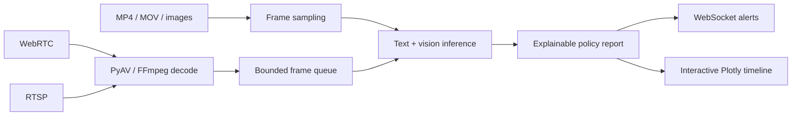

# StreamShield AI

<div align="center">

**Interactive multimodal moderation for live streams and uploaded media**

[](https://www.python.org/)
[](https://fastapi.tiangolo.com/)
[](https://streamlit.io/)
[](https://plotly.com/)
[](https://onnxruntime.ai/)
[](LICENSE)

[Quickstart](#quickstart) · [Interactive cockpit](#interactive-cockpit) · [Upload API](#upload-media-and-explore-the-risk-timeline) · [Live streams](#live-stream-api) · [Performance notes](#performance-and-benchmarks)

</div>

StreamShield AI combines video ingestion, text and image moderation, explainable policy reports, and an interactive Streamlit dashboard. It supports WebRTC and RTSP streams, plus frame-by-frame moderation of MP4, MOV, JPG, JPEG, and PNG uploads.

The inference engine prefers ONNX Runtime's TensorRT execution provider when available, then CUDA, then CPU. PyAV uses native FFmpeg bindings for media decoding; RTSP demux and decode run outside the asyncio event loop. Pinned host buffers and CUDA streams are used for asynchronous transfers when CUDA is available.

> **Performance status:** latency, throughput, VRAM, and concurrency figures in the whitepaper are reference targets, not results reproduced from this checkout. See [Performance and benchmarks](#performance-and-benchmarks).

## At a glance



## Interactive cockpit

Launch the Streamlit app to explore the live moderation studio, stream simulator, upload timeline, analytics, and benchmark visualizations:

```powershell
python -m streamlit run app.py
```

Open `http://localhost:8501`. The Plotly charts in the app are interactive: hover for values, zoom with the wheel, pan by dragging, select regions, reset axes, and export chart images from the Plotly modebar. The upload timeline plots risk against media time in seconds and shows the frame number on hover.

GitHub renders this README as static Markdown and does not execute embedded Plotly JavaScript. Run the cockpit locally to use the interactive plots.

## Quickstart

```powershell
git clone https://github.com/SumedhPatil1507/streamshield-ai.git
cd streamshield-ai
py -3.11 -m venv .venv
.\.venv\Scripts\Activate.ps1
python -m pip install --upgrade pip
python -m pip install -r requirements.txt
python -m streamlit run app.py
```

For the FastAPI streaming server, install its additional dependencies and start it separately:

```powershell
python -m pip install -r requirements-full.txt
python api/webrtc_server.py
```

The cockpit supports an offline demo mode with synthetic imagery. See the requirements files and application configuration for backend-specific dependencies.

## Upload media and explore the risk timeline

The `POST /moderate/upload` endpoint accepts `.mp4`, `.mov`, `.jpg`, `.jpeg`, and `.png` files up to 64 MB. Videos are sampled and analyzed in batches; the response contains per-frame modality scores, a standardized report, summary statistics, and an optional peak-frame thumbnail.

```bash
curl -X POST http://localhost:8000/moderate/upload \
  -F "file=@clip.mp4" \
  -F "sample_fps=2" \
  -F "max_frames=64" \
  -F "caption=Optional transcript or context"
```

The response's `timeline` entries include `t_sec`, `frame`, fused `confidence`, `text_confidence`, `image_confidence`, `alert_level`, and `flagged`. In the cockpit, the interactive Plotly timeline lets you inspect these values over the clip.

## Live-stream API

Start the server with `python api/webrtc_server.py`. The main routes are:

| Route | Type | Purpose |
| :--- | :--- | :--- |
| `POST /offer` | HTTP | Negotiate a WebRTC SDP offer |
| `POST /rtsp/connect` | HTTP | Start RTSP ingestion |
| `POST /rtsp/disconnect/{stream_id}` | HTTP | Stop an RTSP stream |
| `GET /streams` | HTTP | Inspect active stream status |
| `GET /health` | HTTP | Check service health |
| `/ws/alerts` | WebSocket | Receive real-time moderation alerts and send `{"action":"ping"}` heartbeats |
| `POST /moderate/upload` | HTTP multipart | Moderate uploaded video or image media |

Each alert includes transport metadata and a canonical `report` object with exactly these four fields:

```json
{
  "verdict": "CRITICAL TOXICITY VIOLATION",
  "reasoning": "Cross-modal Bayesian probability breakdown (Vision: 94.2%, Text/Audio: 91.8%)",
  "recommendation": "Instant Mute / Quarantine WebRTC Track",
  "next_steps": [
    "Step 1: Terminate active WebRTC media track immediately",
    "Step 2: Issue automated strike notification to the stream host",
    "Step 3: Log frame timestamp and 128-d embedding into PostgreSQL audit trail"
  ]
}
```

The same report shape is returned under `report` by the upload endpoint. WebSocket alert events also carry stream/frame identifiers, scores, latency, and alert status outside the report object.

## Model export and acceleration

Export the repository's reference classifier graphs to ONNX and optionally prepare the ONNX Runtime TensorRT cache:

```bash
python scripts/export_onnx_tensorrt.py --output-dir models --fp16 --build-trt-cache
```

`scripts/export_tensorrt_llm.py` handles the classifier and LLM paths separately:

- The fixed-length text classifier and vision classifier use ONNX Runtime's `TensorrtExecutionProvider` with shape profiles and engine caches.
- An optional converted causal language model can be built with TensorRT-LLM and paged KV cache using `--llm-checkpoint-dir`. In-flight batching is a serving-runtime behavior; building an engine does not start the scheduler.

```bash
python scripts/export_tensorrt_llm.py --output-dir models/trt --export-only
python scripts/export_tensorrt_llm.py --output-dir models/trt \
  --text-onnx models/text_toxicity.onnx \
  --vision-onnx models/image_classifier.onnx \
  --llm-checkpoint-dir /path/to/converted-trtllm-checkpoint \
  --fp16
```

The default reference classifier exporters initialize their own model weights. For deployment, provide ONNX exports containing the trained weights you intend to serve.

## Explainable report contract

Reports are built by `src/moderation_report.py`. The canonical object has exactly `verdict`, `reasoning`, `recommendation`, and `next_steps`. Live alert events wrap that report with transport metadata; upload responses include it under `report` alongside the timeline and statistics.

## Performance and benchmarks

The whitepaper discusses p50/p90/p99 latency, frames per second, VRAM footprint, and concurrency scaling. Its A100 figures are labeled as unverified reference targets: this checkout has no raw A100 run logs, and its current benchmark scripts do not measure full glass-to-alert latency, GPU VRAM, or multi-stream scaling. The inference benchmark measures the active provider; the pipeline benchmark uses a stub engine and measures orchestration overhead.

Run the available benchmark scripts in the environment you want to characterize:

```bash
python scripts/_bench_sla.py
python scripts/_bench_pipeline.py
```

For a reproducible performance claim, record hardware, software versions, model hashes, workload, warm-up, raw latency samples, completed and offered FPS, dropped frames, process VRAM, and simultaneous stream count. Read [docs/PERFORMANCE_WHITEPAPER.md](docs/PERFORMANCE_WHITEPAPER.md) for the measurement definitions and current evidence status.

## Tests

```bash
python -m unittest discover tests
```

The tests cover inference preprocessing, report schema, upload behavior, alert orchestration, and provider-dependent latency budgets. They do not replace an A100 deployment benchmark.

## License

StreamShield AI is licensed under the [MIT License](LICENSE).
